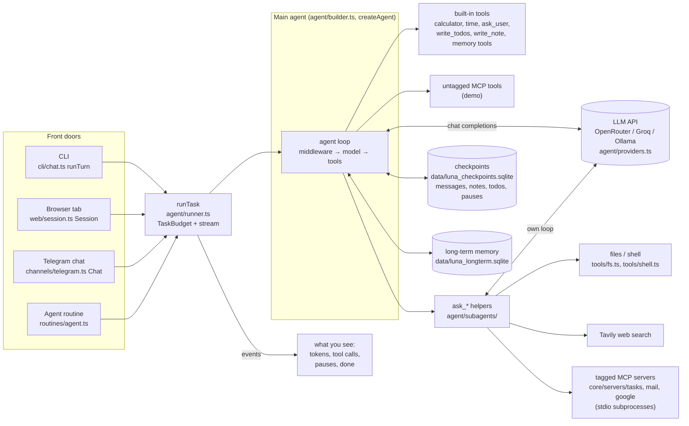
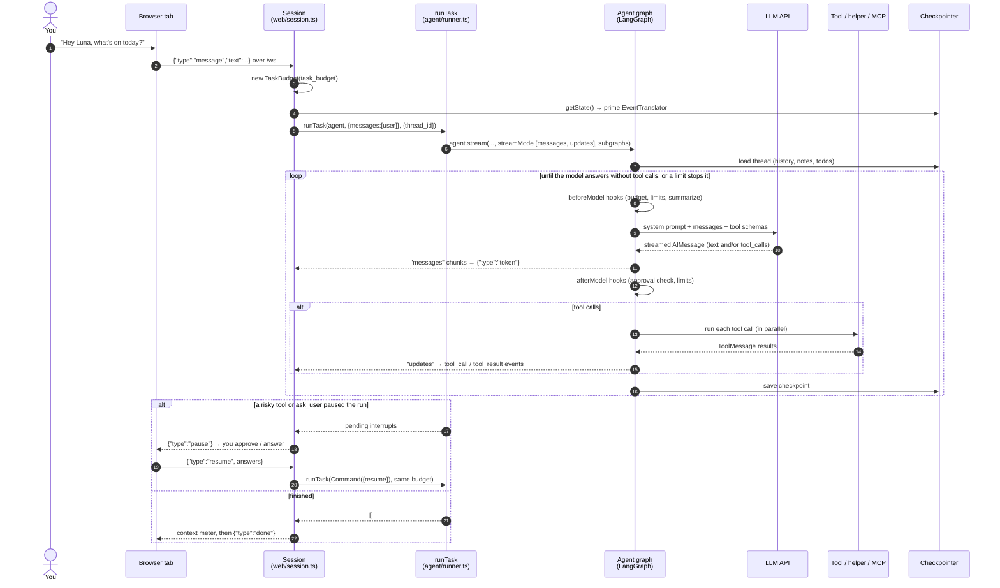
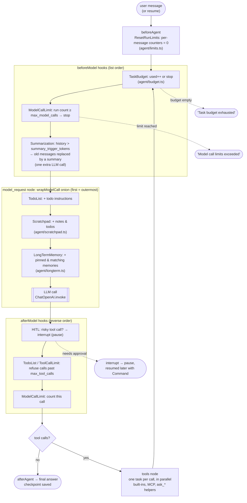
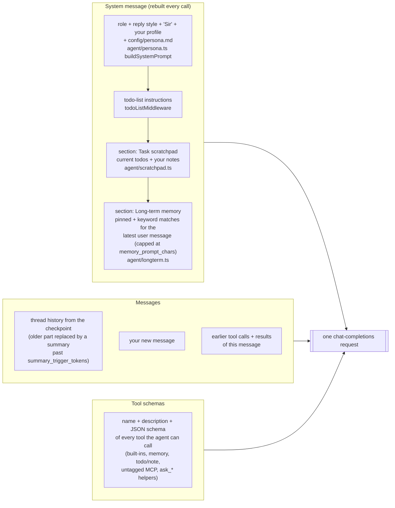

# Architecture

Luna is a general assistant: one main ReAct agent that does quick work
itself and hands bigger jobs to helper subagents. Design history is in
`spec/` (spec1 → spec12); decisions and their reasons in `DECISIONS.md`.
The backend is TypeScript in `core/` (Node runs the `.ts` files directly,
no build step; D41). Module paths below are relative to `core/src/`.
Two front doors share the same agent code: the terminal CLI and a
voice-first web UI (`docs/web-ui.md`). The web UI also has a Control
Center for settings, connectors, permissions, routines and live stats
(`docs/control-center.md`). `luna-web` opens the UI in its own app
window, like a desktop application (`web/window.ts`, D37). A third
front door, a Telegram bot (`channels/`, D39), runs inside `luna-web` so
you can message Luna from your phone: text, voice notes, photos and
approvals (`docs/messaging.md`).

## Topology



The same system as a text map, with every storage file:

```
                         ┌────────────────────────────────────────────┐
 you ── CLI (cli/chat) ──▶ runTurn → runTask (agent/runner)            │
 you ── browser (web/) ──▶ /ws → Session (web/session) → runTask       │
        voice in/out,     │   events → JSON (web/events)                │
 you ── Telegram ────────▶ long poll → Chat (channels/telegram)         │
        text, voice note, │   → runTask; reply text (+ Piper voice      │
        photo, file       │   note), Approve / Reject buttons           │
   ▲     approve/edit/    │   TaskBudget for the whole message          │
   │     reject, answers  └──────────────────┬─────────────────────────┘
   │                                         ▼
   │        ┌──────────────────── MAIN AGENT (agent/builder) ───────────────────┐
   │        │ middleware: ResetRunLimits → TaskBudget → ModelCallLimit →        │
   │        │   ToolCallLimit → TodoList → Scratchpad → LongTermMemory → HITL → │
   │        │   Summarization                                                   │
   │        │ tools: get_current_time, calculator, ask_user, write_todos,       │
   │        │        write_note, recall, remember, suggest_update/_forget,      │
   │        │        untagged MCP tools, ask_* delegates                        │
   │        └───────┬──────────────┬──────────────┬──────────────┬─────────────┘
   │                ▼              ▼              ▼              ▼
   │         ask_researcher    ask_files       ask_coder     ask_assistant
   │         (Tavily)          (fs tools)      (fs + shell)  (tagged MCP: to-dos, mail, calendar)
   │         each: own ReAct loop, limit + timeout, TaskBudget, optional HITL,
   │               fresh context per call, shares the main checkpointer
   │                │              │              │              │
   └──── pauses ◀───┴── interrupt() / HumanInTheLoopMiddleware ──┘

 Storage: data/luna_checkpoints.sqlite (checkpoints: thread history, scratchpad,
          paused helper runs) · data/luna_longterm.sqlite (long-term memory:
          memories, suggestions, history; only the user writes memories)
          · workspace/ (files the helpers may touch) · data/tasks.json (to-dos,
          synced with Google Tasks) · data/google/ (OAuth client + token)
          · data/luna_routines.sqlite (routines, runs, usage counters)
          · data/dashboard.json (HUD widget preferences)
          · data/app-window/ (the app window's browser profile)
          · data/telegram.json (bot update offset, chat → thread id)

 Control Center (luna-web only): browser #/control ── /api/control/* (web/control.ts)
   settings ⇄ .env (config/envfile.ts + schema.ts; validated, rolled back on error)
   MCP servers ⇄ config/mcp_servers.json · Google sign-in · permissions (LUNA_AUTO_APPROVE)
   stats: process, memory, sessions, tools, usage counters (Session → AgentHost.usage)
   routines: RoutineScheduler (routines/) ticks every 30 s →
     builtin: one read-only MCP tool via tool.invoke (no LLM) → HUD widgets
     agent:   runTask on thread routine-<id>, approvals auto-rejected
   → data/luna_routines.sqlite (routines, runs, usage) · data/dashboard.json
   → {"type": "routine_result"} / {"type": "settings_changed"} to every tab

 Google: one sign-in (integrations/google.ts, `pnpm google-auth`) shared by
         mail (Gmail API) · google (Calendar) · tasks (Google Tasks sync).
         The tasks and google servers import the mail server's fetch_email
         to turn an email into a to-do or an event.
```

## One message, end to end

The request, as a sequence (web UI; the CLI and Telegram differ only in
transport):



Inside the agent graph, one loop step at a time. The middleware order comes
from `buildMiddleware` in `agent/builder.ts`:



What one model call actually sends:



More diagrams (helpers inside a message) and how to trace and measure each
prompt are in [`docs/prompt-lifecycle.md`](docs/prompt-lifecycle.md).

In words:

1. `runTurn` creates a `TaskBudget` and calls `runTask` with the message.
2. `runTask` puts the budget in AsyncLocalStorage and streams
   `agent.stream(..., { subgraphs: true })`; the CLI prints text, tool calls
   and helper steps (indented) as they arrive.
3. Before every model call, in any agent, `taskBudgetMiddleware` takes one unit.
   The main agent sees its system prompt (role + persona: style, "Sir",
   user profile, `config/persona.md`; built by `agent/persona.ts`) plus the
   scratchpad (todos + notes) and long-term memory (pinned + keyword
   matches for the message; `agent/longterm.ts`).
4. The model either answers, calls a direct tool, or calls `ask_<helper>`.
   A helper runs its own capped loop and returns ≤ 300 words (the
   researcher: ≤ 60 words of facts; the main agent phrases the reply).
5. A risky tool (write, edit, run, send…) or `ask_user` pauses the graph. The
   run ends; `runTask` returns the pending pauses from `getState()`.
6. `runTurn` asks you, then calls `runTask` again with
   `new Command({ resume: { [id]: answer } })` and the same budget. Repeat
   until no pauses.
7. Any `remember` / `suggest_*` call only queued a suggestion; the user
   accepts or declines it in the web Memory panel or with `/memory`
   (`docs/memory.md`).
8. The checkpointer has saved messages, scratchpad and any paused helper
   state under the thread id; old messages get summarized past 12k tokens
   (the newest ~4k tokens stay word-for-word, so summaries stay rare).

Sessions: a session is a thread id. The CLI and every browser tab start a
new one each time; old ones are listed from the checkpoints and resumed
or deleted on request (`agent/sessions.ts`).

The web path is the same loop split over socket messages: `message` →
steps 1–5, the pauses go to the browser as `pause`, and `resume` is step 6.
Helper events carry `parent` (the `ask_*` call id, passed through the
helper run's metadata) so the HUD can nest them, and each run ends with a
`context` event (thread tokens vs. the summarization point) before
`done` / `pause`. `cancel` (STOP / Esc while running) aborts the run's
AbortSignal, which stops any helpers (and shell commands) inside it.
Protocol: `docs/web-ui.md`.

Telegram (`channels/telegram.ts`): one private chat = one Chat, like a tab.
A message is downloaded and turned into text (voice notes go through
Whisper, photos and files are saved to `workspace/telegram/`; photos also
go in as image blocks when `LUNA_MODEL_VISION=true`) and run with
`runTask`. The reply is the main agent's `token` text, sent when the run
ends (plus a Piper voice note when the message was a voice note). Pauses
become a card with Approve / Reject buttons (`callback_data` holds a prefix
of the pause id), or the next text reply answers them. Only users in
`LUNA_TELEGRAM_ALLOWED_USERS` reach the agent. Routine results reach the
bot as an AgentHost listener.

## Files

```
package.json               pnpm scripts from the repo root: build (web/dist), luna, web, google-auth, test
pnpm-workspace.yaml        the pnpm workspace: core, web, site (one pnpm-lock.yaml)
core/                      the backend (TypeScript, Node ≥ 22.18, D41); package.json + tsconfig
  bin/luna.ts              `pnpm luna [--resume]`: the terminal chat
  bin/luna-web.ts          `pnpm web`: web UI + Control Center + routines + Telegram
  bin/luna-google-auth.ts  `pnpm google-auth`: the one Google sign-in
  src/
    cli/chat.ts            REPL (luna [--resume]), printing, pause handling (runTurn,
                           answerInterrupt), /sessions /resume /delete (sessionCommand),
                           /memory (memoryCommand)
    voice/tts.ts           PiperTTS: espeak-ng phonemes → Piper voice ONNX on onnxruntime (/api/tts)
    voice/stt.ts           WhisperSTT: Whisper ONNX via @huggingface/transformers, silence gate (/api/stt)
    voice/wav.ts           WAV ⇄ 16-bit PCM; voice/download.ts fetches models once
    web/
      server.ts            luna-web: Hono routes + the ws /ws socket, /api/tts, /api/stt,
                           origin check, serves web/dist, starts routines and Telegram;
                           main(): serve + open the app window (or only open one if Luna
                           already runs)
      session.ts           AgentHost (shared agent, model switch, usage), Session per tab
                           (background runs, cancel + cancelCleanup, memory panel messages)
      events.ts            stream events → JSON (deduped by message id); pause describe /
                           answer conversion (LangChain JS camelCase ⇄ browser format)
      window.ts            app window: find a Chromium browser, open --app with its own
                           profile, stop the server when it closes, .desktop launcher entry
      control.ts           /api/control/*: settings, MCP connectors, Google connect, providers,
                           permissions, stats, dashboard prefs, routines, cron check
    channels/
      telegram.ts          TelegramBridge (luna-web starts it when LUNA_TELEGRAM_BOT_TOKEN is set):
                           long-poll loop, allow-list, Chat per private chat, voice / photo / file
                           intake, approvals (buttons or "yes"/"no"/reason), /new /stop /help,
                           routine alerts
      telegram_api.ts      TelegramAPI: the few Bot API calls over fetch; token kept out of errors
      media.ts             decodeAudio (voice note → 16 kHz, ffmpeg), wavToOggOpus (Piper → voice
                           note), pickPhoto, splitText (4096-char limit), safeFilename
    config/settings.ts     all LUNA_* settings: one table (kind, default, description, validator)
    config/envfile.ts      read / edit .env in place (comments kept, atomic)
    config/schema.ts       settings → grouped form schema (secrets masked, live/rebuild/restart);
                           saveSettings (validate, roll back)
    routines/
      cron.ts              5-field cron on a zone's wall clock: parse, nextRun, describe
      store.ts             RoutineStore (SQLite): routines, runs, usage per day
      builtin.ts           mail_check / agenda / todos: one read-only MCP tool each, no LLM
      agent.ts             runAgentRoutine: prompt on thread routine-<id>, approvals rejected
      scheduler.ts         RoutineScheduler: due routines one at a time → routine_result
    agent/
      builder.ts           buildAgent (model, checkpointer, MCP) → assembleAgent (tools,
                           middleware, delegates); assemble again = switch model
      providers.ts         OpenRouter / Groq / Ollama → ChatOpenAI; list models
      persona.ts           buildSystemPrompt: role + reply style + title + user profile + persona file
      runner.ts            runTask: one run with budget + event stream + pending pauses
      budget.ts            TaskBudget (AsyncLocalStorage) + taskBudgetMiddleware
      limits.ts            resetRunLimitsMiddleware: per-message loop limits really reset
      scratchpad.ts        notes state, write_note, scratchpadMiddleware
      sessions.ts          list / resolve / delete saved sessions (threads), newSessionId
      longterm.ts          LongTermStore (SQLite + FTS5, suggestions, history/undo),
                           recall/remember/suggest_* tools, longTermMemoryMiddleware
      memory.ts            checkpointer factory (sqlite / memory)
      types.ts             LunaAgent (the agent methods Luna calls), pauses in a snapshot,
                           agentToolNames
      subagents/
        base.ts            SubagentSpec, makeDelegateTool, needsApproval
        researcher.ts      Tavily web research
        files.ts           workspace files
        coder.ts           code + run_command
        assistant.ts       personal tasks via tagged MCP servers
        index.ts           getSubagentSpecs (which helpers are on, MCP routing)
    tools/
      builtin/             get_current_time, calculator (Python number rules), ask_user
      fs.ts                sandboxed file tools (Workspace)
      shell.ts             run_command (own process group, killed on timeout or cancel)
      limits.ts            capOutput
      registry.ts          ToolRegistry
      runtime.ts           tool call id / thread id from a tool's runtime
    mcp/loader.ts          read MCP config, splitByAgent, isRiskyToolName, MCP clients
    integrations/google.ts Google OAuth shared by the servers: credentials (refresh, scope check,
                           Python token.json format), service, execute, authorize
    util/zoned.ts          wall-clock time in an IANA zone (Intl only)
  servers/
    demo.ts                sample MCP server
    tasks.ts               local to-dos (data/tasks.json) for ask_assistant, two-way
                           synced with Google Tasks; add_task_from_email
    mail.ts                inbox read + send / reply for ask_assistant over the Gmail API
                           (default) or IMAP/SMTP (imapflow, nodemailer); fetchEmail /
                           emailReference for the others (sending asks for approval; docs/mail.md)
    google.ts              Google Calendar for ask_assistant; get_agenda adds to-dos;
                           create_event_from_email via the mail server's fetchEmail (docs/google.md)
    common.ts              text / JSON results, error results, stdio
  test/                    vitest suite (fake models, no API key); helpers.ts = the fake model
config/mcp_servers.json    MCP servers: demo (main), tasks + mail + google (assistant), LangChain docs (researcher)
config/persona.md          optional extra instructions for Luna (git-ignored; see persona.example.md)
web/                       browser UI (Vite + React + React Three Fiber); `pnpm build` → web/dist
  src/App.tsx              voice loop, pauses, keyboard; src/lib (socket, reducer, speech),
  src/core (3D core), src/components (HUD, drawer, pause card, memory panel,
  InsightWidgets), src/components/control (Control Center apps), src/lib/control.ts
  (Control API client), src/lib/protocol.ts (the /ws messages), src/control.css
docs/README.md             index of all docs
docs/configuration.md      every LUNA_* setting, what lives where
docs/cli.md                luna commands, /memory, approvals
docs/agents-and-tools.md   main agent, helpers, MCP servers, how to extend
docs/development.md        setup, layout, tests, web dev, which docs to update
docs/web-ui.md             running the web UI, voice setup, WebSocket protocol
docs/prompt-lifecycle.md   mermaid diagrams of one prompt end to end; how to trace and measure it
docs/control-center.md     Control Center: apps, routines, what applies when, HTTP API
docs/memory.md             short- vs long-term memory, suggestions inbox, /memory
docs/mail.md               mail setup, tools, approval
docs/messaging.md          Telegram bot: setup, voice notes, photos, approvals, security
docs/google.md             Google sign-in (Gmail, Calendar, Tasks), calendar tools, to-do sync, email → to-do / event
site/                      product website (Vite + React): src/content.ts holds all copy,
                           src/sections/* lay it out, public/screens/ real screenshots
                           (demo data); deployed to GitHub Pages by .github/workflows/site.yml
spec/                      design specs; DECISIONS.md; this file
.github/                   CI (core typecheck + tests, web + site test/build), Pages deploy
                           (site.yml), issue and PR templates
LICENSE, CONTRIBUTING.md,  MIT licence, contributor guide, code of conduct,
CODE_OF_CONDUCT.md,        private vulnerability reporting
SECURITY.md
```

## Not built yet

Voice in the CLI, a wake word that works without the web page open,
semantic (embedding) search for long-term memory, and a WhatsApp channel
(see spec11 §6).
