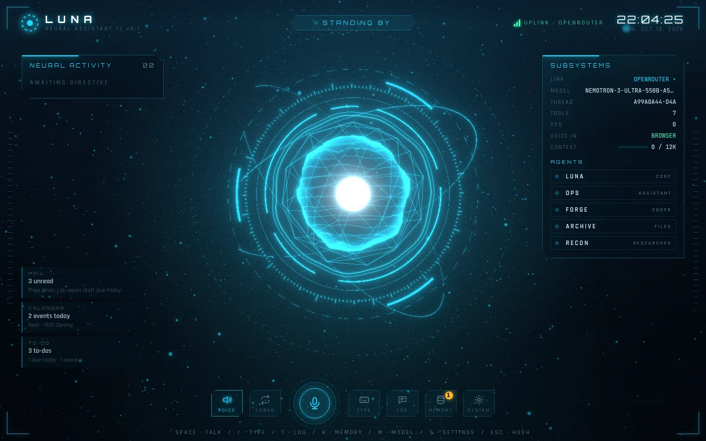

# Luna

[](https://github.com/Akshayshahi900/Luna/actions/workflows/ci.yml)
[](LICENSE)

[](https://akshayshahi900.github.io/Luna/)



A general assistant on LangGraph: one main agent that does quick work
itself and hands bigger jobs to helper agents — **researcher** (web),
**files**, **coder** and **assistant** (to-dos synced with Google Tasks, Gmail and Google Calendar via MCP). Risky
actions (writing files, running commands, sending things) ask you first.

## Requirements

- Python 3.14 and [uv](https://docs.astral.sh/uv/)
- An [OpenRouter](https://openrouter.ai/keys) or [Groq](https://console.groq.com/keys)
  API key, or a local [Ollama](https://ollama.com) model that supports tools
- Node.js 22+ (only for the web UI)

## Quick start

```bash
# 1. Install (uses uv)
uv sync

# 2. Add your OpenRouter credentials to .env
cp .env.example .env
# Replace `your_openrouter_api_key_here` with your key in .env

# 3. Optional: web research — add LUNA_TAVILY_API_KEY (https://app.tavily.com)
#    Optional: Gmail + Calendar + Google Tasks sync — uv run luna-google-auth (docs/google.md)
#    (or IMAP mail with an app password: LUNA_MAIL_BACKEND=imap, docs/mail.md)

# 4. Chat
uv run luna              # always a new session
uv run luna --resume     # continue the most recent one (or --resume <n|id>)
```

Every start (and every web tab or reload) opens a **new session**. In the
CLI, `/sessions` lists saved ones, `/resume <n>` continues one and
`/delete <n>` removes it. In the web UI, open the transcript (**T**) and
click `SESSION · … ▾`.

### Web UI (voice-first)

```bash
cd web && npm install && npm run build && cd ..
uv run luna-web          # open http://127.0.0.1:8765 in Chrome or Edge
```

Voice runs fully on your machine: Luna listens with Whisper and speaks
with Piper (models download once, ~200 MB). Turn on **WAKE** and say
**"Hey Luna, …"** for hands-free use; "Luna, cancel" stops a task. Or press
**Space** to talk, **T** for the chat transcript, **M** to switch
between OpenRouter, Groq and Ollama models. Details and dev
setup: [`docs/web-ui.md`](docs/web-ui.md).

### From your phone (Telegram)

Create a bot with @BotFather, set `LUNA_TELEGRAM_BOT_TOKEN` and your user
id in `LUNA_TELEGRAM_ALLOWED_USERS`, and run `luna-web`. Then send Luna
text, **voice notes** (answered by voice), photos or files, and approve her
actions with a tap. Setup: [`docs/messaging.md`](docs/messaging.md).

The files and coder helpers only touch `./workspace` unless you set
`LUNA_WORKSPACE_DIRS`. When Luna wants to write, edit or run something you
get `[a]pprove / [e]dit / [r]eject`.

Run the tests (no API key needed, the model is faked):

```bash
uv run pytest
cd web && npm test       # web UI logic (vitest)
```

## New here? Read this first

The code can feel like a black box. Start with the beginner walkthrough:

→ **[`spec/beginner-guide.md`](spec/beginner-guide.md)**

It explains, in plain English:

- what an agent / tool / MCP / checkpointer is
- what happens when you type a message
- which file to open first
- how to add your own tool

## Documentation

Everything is indexed in [`docs/`](docs/README.md). The most useful pages:

- [`docs/configuration.md`](docs/configuration.md) — every `LUNA_*` setting
- [`docs/cli.md`](docs/cli.md) — terminal commands, `/memory`, approvals
- [`docs/agents-and-tools.md`](docs/agents-and-tools.md) — helpers, MCP servers, adding your own tools
- [`docs/development.md`](docs/development.md) — layout, tests, web dev

- [`ARCHITECTURE.md`](ARCHITECTURE.md) — how the pieces fit, one message end to end
- [`DECISIONS.md`](DECISIONS.md) — why things are the way they are
- Specs: [`spec1`](spec/spec1.md) (core agent), [`spec2`](spec/spec2.md)
  (loop limits, when to use subagents), [`spec3`](spec/spec3.md) (helpers,
  task budget, scratchpad, approval), [`spec4`](spec/spec4.md) (web UI)

## Contributing

Contributions are welcome — see [`CONTRIBUTING.md`](CONTRIBUTING.md) and the
[Code of Conduct](CODE_OF_CONDUCT.md). Found a security issue? Please follow
[`SECURITY.md`](SECURITY.md) instead of opening a public issue.

## License

[MIT](LICENSE) © Akshay Shahi
