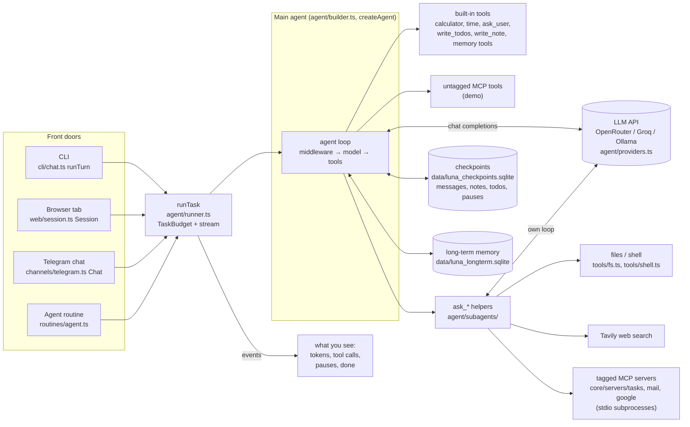
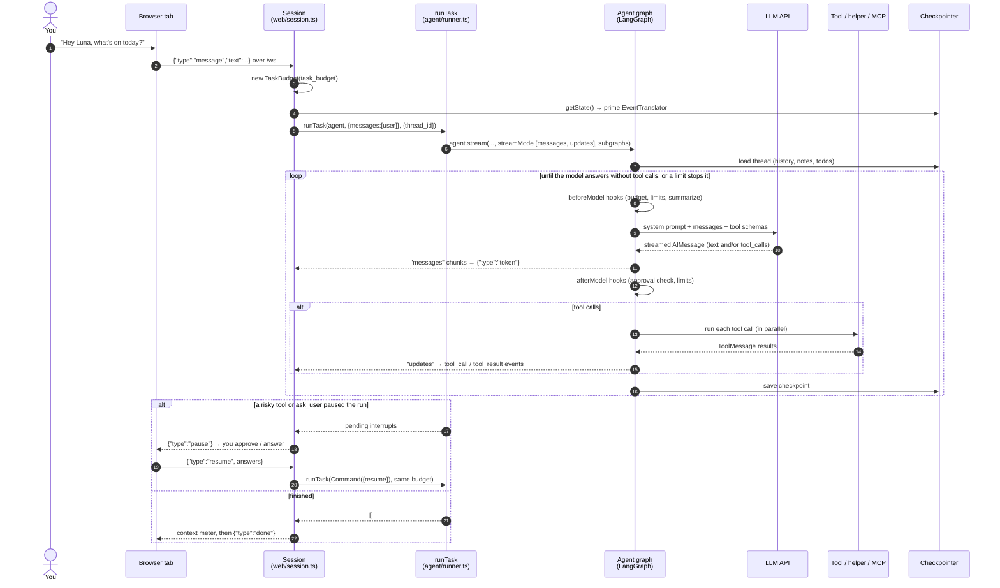
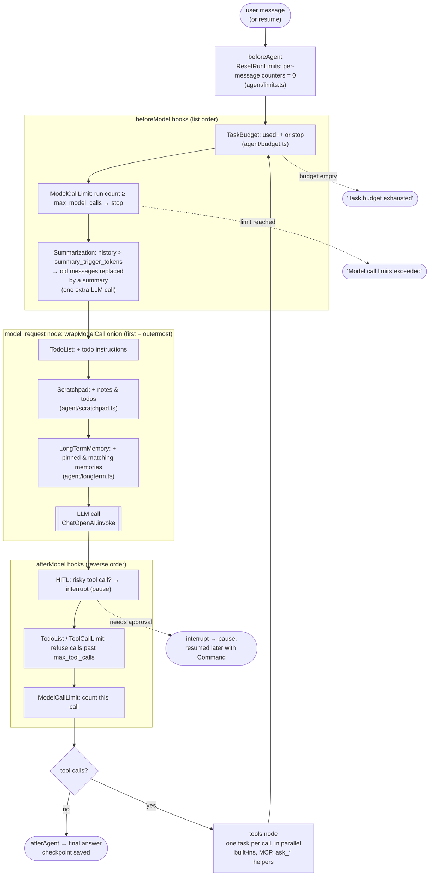
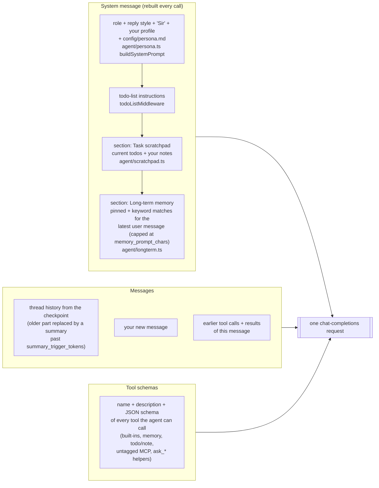
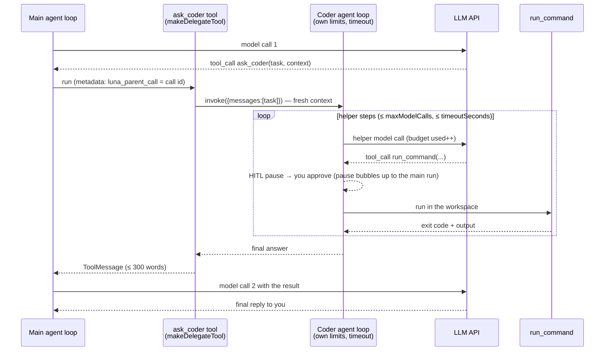
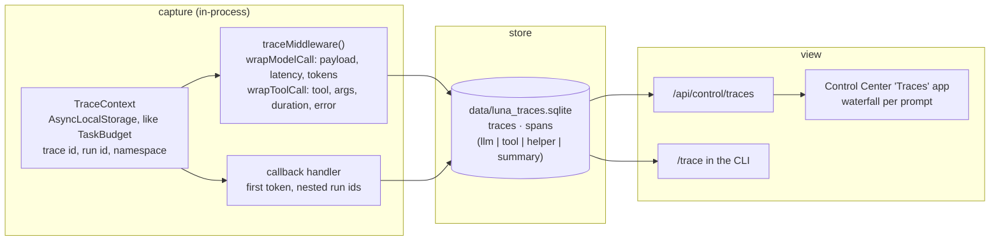

# The life of a prompt

What happens to one message you give Luna: where it enters, every step the
agent loop takes, what is actually sent to the model, where tools and
helpers run, and when it stops. The last section lists what to measure and
where in the code to hook in to trace each prompt.

Paths are relative to `core/src/`. Background: [`ARCHITECTURE.md`](../ARCHITECTURE.md),
design: [`spec/spec12.md`](../spec/spec12.md).

---

## 1. The big picture

Four front doors, one agent. Everything goes through `runTask`
(`agent/runner.ts`).

## 2. One message, end to end (web UI)

The CLI and Telegram work the same way. Only the transport differs.

## 3. The agent loop, hook by hook

`createAgent` turns the middleware list from `buildMiddleware`
(`agent/builder.ts`) into graph nodes. The order is fixed, and it decides
what the model sees and when the run stops:

So one **loop** (one "step") = one trip through `beforeModel → model_request
→ afterModel → tools`. A message ends when the model replies without tool
calls, or a limit stops it: `max_model_calls` (per agent),
`max_tool_calls`, or `task_budget` (all agents together).

## 4. What the LLM actually receives

Each model call sends three things. Most of the system prompt is rebuilt on
every call, so an edit to a memory or a note applies at once:

A **helper** (`ask_files`, `ask_coder`, `ask_researcher`, `ask_assistant`)
gets a much smaller request: its own system prompt, only the `task` (+
`context`) the main agent wrote, and only its own tools. It never sees the
conversation (`agent/subagents/base.ts`).

## 5. Helpers inside a message

A helper is a tool that runs a whole agent of its own. Its model calls count
against the same `TaskBudget`.

In the event stream, helper steps carry a namespace (`tools:<id>`) and
`parent` (the `ask_*` call id), which is how the web UI nests them
(`web/events.ts`).

---

## 6. Measuring every prompt

What you want per prompt: which tools ran, how many loops, the exact
payload sent to the LLM, tokens, and how long each part took.

### What already exists

| Already there | Where | Gives you |
| --- | --- | --- |
| Event stream | `runTask` `onEvent` (`agent/runner.ts`), turned into JSON by `EventTranslator` (`web/events.ts`) | every tool call and result, helper nesting, notices, reply tokens |
| Counters per run | `Session.#counts` → `AgentHost.recordUsage` (`web/session.ts`) | model calls, tool calls, errors |
| Daily usage | `usage` table in `data/luna_routines.sqlite` (`routines/store.ts`) | totals per day / provider / model, shown in the Control Center |
| Budget | `TaskBudget.used` (`agent/budget.ts`) | model calls across main agent + helpers |
| Thread state | checkpointer (`getState`) | the final messages, notes and todos |

Those are totals. They don't give you a per-prompt trace with timings or
the exact payload.

### Where to hook in

| You want | Hook | Notes |
| --- | --- | --- |
| **Exact LLM payload** (system message, messages, tool schemas) | a `wrapModelCall` middleware placed **last** in `buildMiddleware` (and in `makeDelegateTool` for helpers) | The first middleware is the outermost, so the last one sees the request after TodoList, Scratchpad and LongTermMemory have added their parts: `request.systemMessage`, `request.messages`, `request.tools`, `request.model` |
| **Per-call latency + tokens** | the same wrapper: time `await handler(request)`; read `usage_metadata` from the returned AI message | ChatOpenAI streams usage by default (`streamUsage: true`); OpenRouter and Groq report `input_tokens` / `output_tokens` |
| **Time to first token** | LangChain callback `handleLLMNewToken` (pass `callbacks: [handler]` in the `runTask` config) | Callbacks reach helpers too; `parentRunId` gives the call tree |
| **Tool name, args, duration, result size, errors** | a `wrapToolCall` middleware: `request.toolCall`, time `handler(request)` | Covers built-ins, MCP tools and `ask_*` helpers (a helper's whole run is one tool call; its inner calls show up under its own loop) |
| **Number of loops** | count model calls per (run, namespace); or count `model_request` updates in `onEvent` (`isModelUpdate`) | namespace `[]` = main agent, `["tools:<id>"]` = a helper |
| **Why it stopped** | the final message text (`Task budget exhausted`, `Model call limits exceeded`), interrupts from `runTask`, or an error | |
| **Total time / pauses** | wrap `runTask` in `Session.#execute`, `runTurn`, `Telegram #run`, `runAgentRoutine` | a paused message spans several runs: give them one trace id (e.g. created with the `TaskBudget`) |
| **Summarization cost** | the summarizer's model call (it has no system message) | an extra LLM call inside `beforeModel` |

### A suggested design

Keep it local, like the rest of Luna. Your prompts, memories and email text
end up in these traces, so they should stay on your machine.

1. **A `TraceContext`** in `AsyncLocalStorage`, set next to the
   `TaskBudget` in `runTask`: `{traceId, threadId, source: "web"|"cli"|"telegram"|"routine"}`.
   One trace = one user message, resumes included.
2. **`traceMiddleware()`** (new `agent/trace.ts`), appended **last** in
   `buildMiddleware` and in `makeDelegateTool`:
   - `wrapModelCall`: record `{span: "llm", agent: name, step, model,
     system, messages, tools, started, duration, input_tokens,
     output_tokens, tool_calls}`.
   - `wrapToolCall`: record `{span: "tool", name, args, duration,
     result_chars, error}`.
3. **A small SQLite store** (same pattern as `routines/store.ts`): a
   `traces` table (one row per message: source, thread, started, duration,
   steps, model calls, tool calls, tokens, stop reason) and a `spans` table
   (one row per LLM or tool call, with a `parent_span`). Store the payload
   as JSON, trim the oldest traces (like `KEEP_RUNS`), and add a setting
   such as `LUNA_TRACE_PAYLOADS=true|false` so you can keep timings only.
4. **A view.** Add `GET /api/control/traces` and `GET /api/control/traces/:id`
   in `web/control.ts`, and a waterfall in the Control Center (one bar per
   span, helpers nested under their `ask_*` call). In the CLI, `/trace`
   prints the last message's spans.
5. **Tests**, with the fake model (`test/helpers.ts`). `FakeToolModel`
   already records `systemPrompts` and `inputs`. Check that a traced run
   has the same step count, tool names and system prompt as the model saw,
   and that a helper's spans hang under its `ask_*` span.

### Quick options before building it

- **LangSmith** (zero code): set `LANGSMITH_TRACING=true` and
  `LANGSMITH_API_KEY=...` in `.env`. LangChain then sends every run tree,
  with prompts, tool calls, tokens and timings, to LangSmith's cloud. It's
  the fastest way to look, but your conversations leave the machine.
- **Langfuse / OpenTelemetry** (self-hostable): a LangChain callback handler
  exports the same tree to a server you run yourself.
- **Timings only, today:** log `performance.now()` around `runTask` and
  count `onEvent` events by type (`tool_call`, `tool_result`, and
  `isModelUpdate` for model calls). That fits in a few lines in
  `Session.#execute`.

### What to look at once you have it

- **Steps per message:** most should be 1–3. Many steps means the model
  is looping on a tool.
- **Tokens per call:** watch the system prompt (memories, notes) and the
  tool schemas. MCP tools add their schemas to every main-agent call.
- **Latency split:** model time vs tool time vs your approval wait.
- **Helper cost:** helper model calls vs main-agent calls, per helper.
- **Stop reasons:** how often messages hit `max_model_calls` or
  `task_budget`, which is a sign the limits or prompts need tuning.
